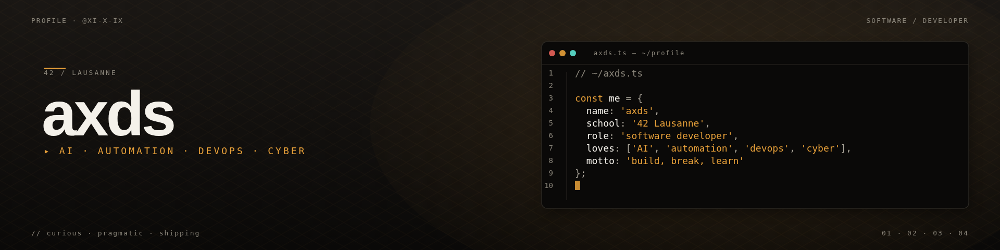

### Étudiante à 42 Lausanne · Backend, DevOps & Cybersécurité

**Je cherche un stage** — Développeuse Junior · Backend · DevOps / SRE · IA 
Disponible immédiatement · Suisse romande, Europe ou remote · Français / English

---

## En bref

- **Common Core 42 terminé (100 %)**, niveau **11 / 21** — spécialisations en cours : **IA / Data** et **cybersécurité**.
- Solide base **bas niveau en C / C++** : gestion mémoire manuelle, algorithmie, systèmes Unix.
- Je construis des outils concrets : **pipeline DevSecOps** (GitHub Actions, Terraform, Kubernetes), **infra Docker multi-services** avec monitoring, **auditeur de sécurité web** automatisé, **agents IA 100 % locaux**.
- Ce qui me motive : comprendre comment les systèmes fonctionnent *réellement*, puis les automatiser et les sécuriser.

<b>🇬🇧 English summary</b>

 

Student at **42 Lausanne** (Common Core completed, level 11/21, now specialising in **AI/Data** and **cybersecurity**).
Strong low-level foundations in **C/C++**, hands-on projects in **DevSecOps CI/CD**, **Docker infrastructure & monitoring**, **web security auditing** and **local AI agents**.
**Looking for an internship** (Junior / Backend / DevOps / SRE / AI) — available now, Switzerland, Europe or remote. Contact: **axds.contact@gmail.com**

---

## Projets phares

<table>
<tr>
<td width="50%" valign="top">

### 🔐 [SecureCI](https://github.com/XI-X-IX/SecureCI)
Pipeline **DevSecOps** de bout en bout : analyse statique (Bandit), audit des dépendances (Safety), détection de secrets (TruffleHog), scan d'images (Trivy), puis déploiement **Terraform + Kubernetes**.

`Python` `Flask` `GitHub Actions` `Terraform` `Kubernetes`

</td>
<td width="50%" valign="top">

### 🐳 [Inception](https://github.com/XI-X-IX/Inception)
Infrastructure **Docker** complète orchestrée avec Compose : NGINX (TLS), WordPress, MariaDB, Redis, FTP, avec **monitoring Prometheus / Grafana**.

`Docker` `Docker Compose` `NGINX` `Prometheus` `Grafana` `Bash`

</td>
</tr>
<tr>
<td width="50%" valign="top">

### 🛡️ [Audit](https://github.com/XI-X-IX/Audit)
Auditeur de sécurité **SaaS automatisé** : headers HTTP, SSL/TLS, scan de ports, endpoints sensibles, cookies. Génère un rapport **JSON + PDF** avec un score sur 100.

`Python` `ReportLab` `SSL/TLS`

</td>
<td width="50%" valign="top">

### 🤖 [CrewAI Agents](https://github.com/XI-X-IX/CrewAI)
Trois équipes d'**agents IA exécutées en local** (Ollama, aucune donnée envoyée à l'extérieur) : création de contenu, assistant e-commerce, détection de produits gagnants.

`Python` `CrewAI` `Ollama` `LLM`

</td>
</tr>
</table>

<b>Autres projets</b>

 

| Projet | Description | Stack |
|--------|-------------|-------|
| **[network_scan](https://github.com/XI-X-IX/network_scan)** | Scanner réseau CLI multi-thread — détection d'hôtes, ports et protocoles | Python · Sockets · Threads |
| **[LinearRegression](https://github.com/XI-X-IX/LinearRegression)** | Régression linéaire *from scratch* (descente de gradient) avec métriques MAE / RMSE / R² | Python · matplotlib |
| **[push_swap](https://github.com/XI-X-IX/push_swap)** | Algorithme de tri optimisé sur piles, parsing robuste et gestion mémoire manuelle | C |
| **[so_long](https://github.com/XI-X-IX/so_long)** | Jeu 2D codé *from scratch* avec la MiniLibX | C · MiniLibX |
| **[axds.ch](https://axds.ch)** | Portfolio personnel ([code source](https://github.com/XI-X-IX/http)) | Next.js · TypeScript · Tailwind |
| **[intern-bot](https://github.com/XI-X-IX/intern-bot)** | Bot Telegram de veille d'offres d'emploi en Suisse romande (scraping + filtrage) | Python · BeautifulSoup |
| **[Trading](https://github.com/XI-X-IX/Trading)** | Bots de trading crypto multi-stratégies (RSI, MACD, Bollinger, Freqtrade) | Python · python-binance · Freqtrade |
| **[PythonPiscine](https://github.com/XI-X-IX/PythonPiscine)** | Piscine Python 42 — des bases à la programmation orientée objet | Python |

---

## Compétences

| Domaine | Technologies |
|---------|--------------|
| **Langages** | C · C++ · Python · TypeScript · Bash |
| **DevOps / Cloud** | Docker · Docker Compose · Kubernetes · Terraform · GitHub Actions · Prometheus · Grafana · NGINX |
| **Sécurité** | SAST (Bandit) · Trivy · TruffleHog · Nmap · Wireshark · TryHackMe |
| **IA / Data** | CrewAI · Ollama · LLM locaux · matplotlib · ML *from scratch* |
| **Systèmes & outils** | Linux · Git · Vim |

---

**Un projet, une offre de stage, une question ?** → [axds.contact@gmail.com](mailto:axds.contact@gmail.com) · [axds.ch](https://axds.ch)

