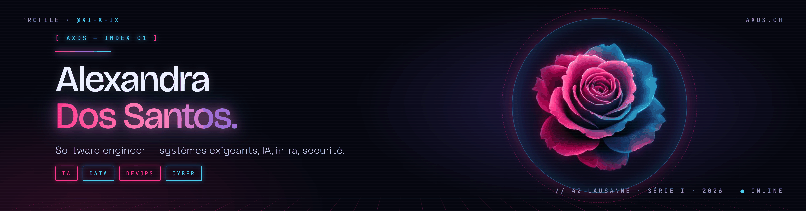

 

 

`[ À PROPOS · 01 ]`

## De la vente *à la tech.*

Développeuse à **[42 Lausanne](https://42lausanne.ch/)**, passionnée par les systèmes exigeants : **intelligence artificielle**, **ingénierie de la donnée**, **automatisation** et **sécurité**.

Huit ans en environnements exigeants — Assistant Manager au Southbank Centre (Londres), Sales Expert chez Philip Morris — m'ont formée à la rigueur opérationnelle. Depuis 2024, je transforme cette exigence en ingénierie. Je suis attirée par le bas niveau — C, systèmes, réseau — parce qu'il force à comprendre **ce qui se passe vraiment sous les abstractions**.

> *« Il n'est jamais trop tard pour devenir qui l'on aurait pu être. »*

 

---

`[ DOMAINES · 02 ]`

## Quatre axes

| | Domaine | Approche |
|:--|:--|:--|
| `01` | **Intelligence Artificielle** | Machine learning, modèles prédictifs, fondamentaux mathématiques — de la régression à l'apprentissage profond. |
| `02` | **Data Engineering** | Pipelines, parsing, stockage, visualisation — transformer la donnée brute en information exploitable. |
| `03` | **DevOps** | Docker, orchestration, CI/CD, infrastructure as code — industrialiser le déploiement et la fiabilité. |
| `04` | **Cybersécurité** | Hardening système, analyse de vulnérabilités, architecture robuste. |

 

---

`[ PROJETS · 03 ]`

## Sélection

| Projet | Description | Domaine | Stack |
|:--|:--|:--|:--|
| **[ft_linear_regression](https://github.com/XI-X-IX/LinearRegression)** | Régression linéaire *from scratch* — descente de gradient maison, normalisation, métriques MAE / RMSE / R² | `IA` `Data` | Python · NumPy · Matplotlib |
| **[CrewAI Agents](https://github.com/XI-X-IX/CrewAI)** | 3 équipes d'agents IA *100 % locales* (Ollama + Mistral 7B) — contenu, e-commerce, product hunting | `IA` | Python · CrewAI · Ollama · LangChain |
| **[SecureCI](https://github.com/XI-X-IX/SecureCI)** | Pipeline DevSecOps de bout en bout — Bandit, Safety, TruffleHog, Trivy, Terraform, Kubernetes | `DevOps` `Cyber` | GitHub Actions · Terraform · K8s |
| **[ft_transcendence](https://github.com/XI-X-IX/ft_transcendence)** | Plateforme web multijoueur temps réel — auth, tournois, chat, OAuth2, WebSocket | `Web` `DevOps` | TypeScript · NestJS · Prisma · Docker |
| **[Minishell](https://github.com/XI-X-IX/minishell)** | Shell UNIX en C — pipes, redirections, variables d'environnement, signaux, heredoc | `Systèmes` | C · Unix |

<b>Tous les projets</b>

 

**IA · Data**

| Projet | Description | Stack |
|:--|:--|:--|
| **[Trading](https://github.com/XI-X-IX/Trading)** | Bot crypto Freqtrade avec stratégie DCA validée par backtests 2022–2024, bots Binance (RSI, MACD, Bollinger), déployé en Docker derrière Cloudflare Tunnel | Python · Freqtrade · Docker |
| **[intern-bot](https://github.com/XI-X-IX/intern-bot)** | Bot Telegram de veille d'offres d'emploi en Suisse romande — scraping et filtrage | Python · BeautifulSoup |
| **[PythonPiscine](https://github.com/XI-X-IX/PythonPiscine)** | Piscine Python 42 — de la syntaxe aux objets, en passant par les exceptions | Python |

**DevOps · Cyber**

| Projet | Description | Stack |
|:--|:--|:--|
| **[Inception](https://github.com/XI-X-IX/Inception)** | Infrastructure web conteneurisée — NGINX, WordPress, MariaDB, Redis, Prometheus / Grafana, FTP | Docker · Compose · Bash |
| **[Audit](https://github.com/XI-X-IX/Audit)** | Auditeur automatisé — headers HTTP, SSL/TLS, ports, endpoints sensibles, cookies. Rapport JSON + PDF noté /100 | Python · reportlab |
| **[network_scan](https://github.com/XI-X-IX/network_scan)** | Scanner réseau CLI — détection d'hôtes, ports et protocoles | Python · Sockets · Threads |
| **[Born2beRoot](https://github.com/XI-X-IX/Born2beRoot)** | VM Debian durcie — SSH, UFW, politiques de mot de passe, audit et journalisation | Debian · Shell |

**Systèmes**

| Projet | Description | Stack |
|:--|:--|:--|
| **[ft_irc](https://github.com/XI-X-IX/ft_irc)** | Serveur IRC conforme RFC 1459 — sockets, `poll()`, multi-clients | C++ |
| **[cub3d](https://github.com/XI-X-IX/cub3d)** | Moteur 3D par raycasting, inspiré de Wolfenstein 3D | C · MiniLibX |
| **[push_swap](https://github.com/XI-X-IX/push_swap)** | Tri optimal sur deux piles avec un jeu d'opérations restreint | C |
| **[so_long](https://github.com/XI-X-IX/so_long)** | Mini-jeu 2D *from scratch* | C · MiniLibX |

**Web**

| Projet | Description | Stack |
|:--|:--|:--|
| **[axds.ch](https://axds.ch)** | Portfolio personnel — direction artistique éditoriale, animations fluides, export statique ([repo](https://github.com/XI-X-IX/axds.ch)) | Next.js · TypeScript · Tailwind |

 

---

`[ PARCOURS · 04 ]`

## Trajectoire

| Période | Étape | |
|:--|:--|:--|
| `2015 – 2023` | **8 ans dans la vente** — Southbank Centre · Philip Morris International · JTI | Paris · Londres · Lausanne |
| `2024 – 2026` | **Cursus 42 Lausanne** — programmation système C / C++, DevOps, réseau, Linux | Common Core terminé |
| `2025 – 2026` | **Certifications TryHackMe** — DevSecOps · AI Security | Top 3 % |
| `2026` | **Stage de fin de cursus** — 6 mois en IA, Data, DevOps ou Cybersécurité | ◆ *Recherche active* |
| `2026 – 2029` | **Master en Informatique** — spécialisation IA, Data et Cybersécurité | Suisse |
| `2029 +` | **Ingénieure Software · Security · Data** | Europe |

 

---

`[ STACK · 05 ]`

## Outils

| | |
|:--|:--|
| **IA · Data** |      |
| **DevOps** |       |
| **Systèmes** |      |
| **Cyber** |     |
| **Web** |     |

 

---

`[ CONTACT · 06 ]`

### En recherche d'un stage de 6 mois
**IA · Data · DevOps · Cybersécurité** — Suisse · Europe · Remote

 

  

AXDS.CH · LAUSANNE · ÉDITION 2026

